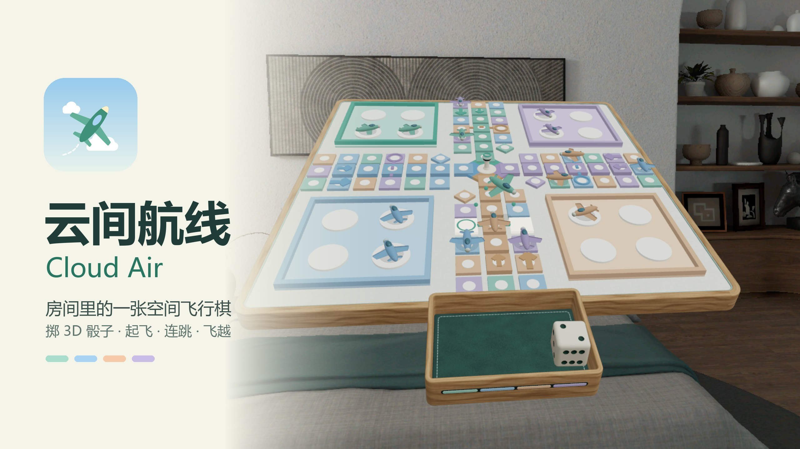

# 云间航线 Cloud Air



Aeroplane chess (飞行棋) as a miniature airport on your table, for PICO OS 6 Shared Space.
PICO Spatial SDK 6.1.9 · SpatialUI · Noto Sans · Kotlin.

- **The board** is a Volumetric window: the classic mat (0.72 m, tipped 28° toward you) with four corner
  hangars, a 52-cell loop round the cross, four home lanes to a control tower, low-poly Blender planes in
  four fleet colours, and a dice tray in front with a real 3D die. Pinch the die (or the tray) to throw it: the
  die tumbles, bounces off the walls and comes to rest showing the committed result. Planes hop cell by cell,
  jump four on their own colour, barrel-roll across the opposite arm on the fly-over, and spin once when they
  reach the tower.
- **The control window** sits to the right: new game (2–4 seats, human or AI easy / smart), the roll button, the
  six choice (launch or move), manual plane picking, pause / settings / rules / victory. 中文 / English.

## Rules (classic, simplified)

1. Roll a six to launch a plane onto the launch pad; any six rolls again.
2. Other rolls move a plane. Landing on your own colour jumps four spaces ahead (once).
3. Landing on the ringed cell of your colour flies straight across the opposite arm, sending home a plane parked
   on the crossed lane cell, then jumps four as well.
4. Landing on other fleets sends them back to their hangar; your own planes may stack.
5. The centre needs an exact roll; extra steps walk back. First fleet with four planes home wins.

## Build and run

```bash
JAVA_HOME='C:\Users\Admin\.pico\primer-cli\jdk\jdk-21.0.12.1+1' PICO_HOME='C:\Users\Admin\AppData\Local\PICO\sdk' \
  ./gradlew.bat assembleDebug :app:testDebugUnitTest --no-daemon
adb install -r app/build/outputs/apk/debug/app-debug.apk
adb shell am start -n io.embodit.cloudair/.platform.LaunchActivity
```

`tools/dev.sh` wraps build / test / install / launch / log / screenshot for the PICO emulator; `AGENTS.md`
documents the code layout, the debug broadcasts and the SDK pitfalls; `design/design-doc.md` is the design
contract (board topology, colours, motion); `docs/review/` and `docs/test/` hold the review and QA rounds.

## Credits

Upstream concept, Blender airplane and die models: the Cloud Air V4 design package (Codex, 2026-10).
Noto Sans: SIL Open Font License 1.1 (`third_party/noto-sans/OFL.txt`). Sound effects are synthesised by
`tools/make_sounds.py`.
